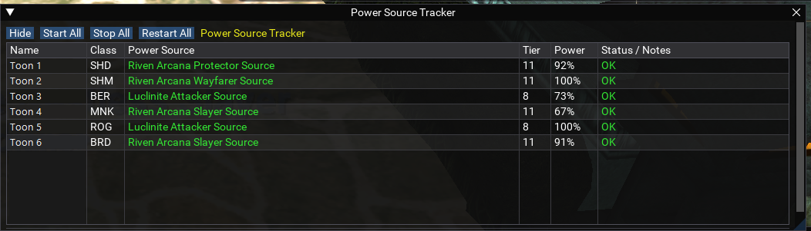

# ps_tracker

Power Source tracker and auto-swap for EverQuest boxing crews.

> Equips from your own bags automatically. Trades only happen when you click Trade.



## Features

- ImGui overlay showing every toon's equipped PS: name, tier, power%, and status
- Auto-detects spent or missing Power Sources and swaps in a fresh one from your own bags (same role). If no matching-role PS is available it equips the best other-role PS as a stopgap (shown as WRONG ROLE)
- Handles sealed PS items: opens ItemDisplayWindow, clicks Convert, equips the result (only if it fits your role and is an upgrade)
- Coordinates trades across toons: the UI shows who has a spare and a Trade button; trades are only ever requested by a click, never automatically
- Broadcasts PS state to all peers via the MacroQuest actors module
- Trades a single Power Source out of a stack (ctrl-click split), with a handshake between giver and recipient, a cursor check before every pickup, and a verify step afterwards
- Stop All stops the script on your other toons from one toon (through the MacroQuest actors module, no extra plugin). Start All and Restart All start it again through MQ2DanNet
- Never destroys or deletes items

## Requirements

- MacroQuest with Lua support (the actors module that ps_tracker uses to talk to your other toons is built in)
- MQ2DanNet: optional, only for the Start All and Restart All buttons (a script that is not running cannot receive an actor message, so starting it on another toon needs DanNet). Without DanNet those two buttons are greyed out and Stop All still works
- MQ2Nav (preferred) or MQ2MoveUtils (fallback, uses /moveto): optional, only for walking to a trade partner. Without either, tracking, converting and equipping still work, and a trade is cancelled with a message
- Plugins that act on the cursor or on trade windows (MQ2Cursor, MQ2AutoLoot, MQ2AutoAccept) can interfere with picking up, equipping and trading items. The script prints a one-time note at startup if one of them is already loaded; if a pickup or trade fails, try unloading it. Likewise, chase or follow scripts can fight `/nav` while a toon walks to a trade partner, so pause them during a trade

## Install

Copy the `ps_tracker` folder into your `MQ/lua/` directory so the layout is:

```
MQ/lua/ps_tracker/init.lua
```

## Usage

Run on every toon:

```
/lua run ps_tracker
```

Or run it on one toon and click **Start All** (needs MQ2DanNet) to start it on the others. If you want it on every login, you can optionally add `/lua run ps_tracker` to your own MacroQuest cfg file; that is a personal choice, not a requirement.

Toons on more than one PC need to know each other through the MacroQuest actors network: add the other PC to `[NetworkPeers]` in `MacroQuest.ini` (see the MacroQuest actors documentation). The actors module also stops working if MacroQuest.exe (the launcher) exits.

All your toons should run the same ps_tracker version: Stop All and Restart All talk to older versions only if they understand the stop message (v1.0.0 does not; on those, use `/ps stop`).

### Commands

| Command | Description |
|---|---|
| `/ps stop` | Stop the script |
| `/ps ui` | Toggle the ImGui window |
| `/ps swap` | Equip a fresh PS from your own bags now (works for a spent PS or an empty slot; does nothing if the equipped PS is not spent). The work runs on the next tick of the script |
| `/ps scan` | Force immediate re-scan and broadcast |
| `/ps convert` | Convert the first sealed PS in bags (via ItemDisplayWindow). The result stays unsealed in your bags. The command does not equip it, and automatic equipping is paused for about 10 seconds afterwards; a later automatic scan may equip it if your slot needs a PS |

## Safety

- Never destroys or deletes items; the cursor is checked before every pickup.
- Start All sends to every DanNet peer, not just your group. Stop All only reaches toons that are running ps_tracker.
- Trades only happen when you click a Trade button: on your own row to request a Power Source for yourself, or on a spare-holder's row when you are the giver. Only your own known toons take part.

## Power Source database

Tier and role come from small tables in `init.lua`. Named sets ("Riven Arcana Slayer Source" and its "Sealed" form) are derived from `PS_SETS` (set name -> tier) and `PS_ROLE_WORDS` (Slayer, Protector, ...), so a new expansion set is normally one line in `PS_SETS`. One-off generic sources are listed by full name in `PS_DB`. Tiers go from 3 (old Ring of Scale orbs) up to the current expansion's tier. A power source the game recognizes (`Item.WornSlot('powersource')`) that is not in these tables is skipped, with a one-time chat message so it can be reported and added.

Role mapping:

| Role | Classes |
|---|---|
| `tank` | WAR, PAL, SHD |
| `melee` | BER, ROG, MNK, RNG, BST, BRD |
| `caster` | WIZ, MAG, NEC, ENC |
| `healer` | CLR, DRU, SHM |

## License

MIT
